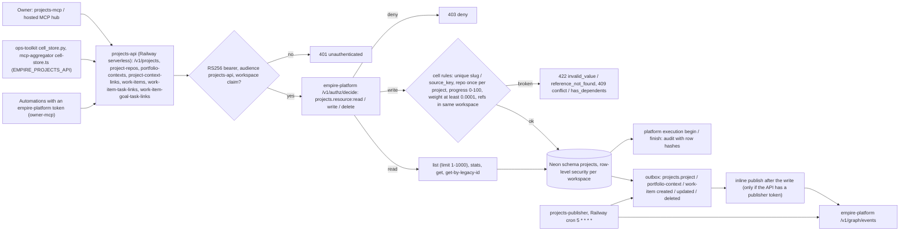

# 01 — Business process (As-Is / To-Be)

life-projects-api คือ cell "Projects and portfolio" ที่เก็บโปรเจกต์ของ owner กับ repository ของแต่ละโปรเจกต์, portfolio context ที่โปรเจกต์สังกัด (ซ้อนกันได้) และ work item (epic, story) ที่ลิงก์ไปยัง task และ goal task ของ cell อื่น owner และ automation เรียกผ่าน API ด้วย token ของ empire-platform ส่วน cell ส่ง graph events ของ project, portfolio context และ work item ไปที่ platform

Last reviewed: 2026-11-27 · commit `62d5b0e`

## As-Is (จากโค้ดวันนี้)

Sources: `cell.yaml`, `.railway/railway.ts`, `pyproject.toml` (platform-cellkit v1.0.11: `cellkit/app.py`, `cellkit/auth.py`, `cellkit/publisher.py`, `cellkit/server.py`), `README.md`, `PRODUCT.md`

ข้อเท็จจริงสำคัญจากโค้ด:

- เฉพาะ `project`, `portfolio-context` และ `work-item` มี `graph` ใน `cell.yaml` จึงเขียน outbox; project-repo และ link ทั้งสามชนิดไม่ส่ง event
- `goal_id`, `task_id`, `goal_task_id` เป็นเลขธรรมดา ไม่ใช่ foreign key: cell ไม่ตรวจว่ามีอยู่ใน cell อื่น; `progress_percent`, `task_count` และรายได้ไม่ได้คำนวณ (ผู้เรียกส่งมาเอง)
- ไม่มีการบังคับลำดับวันที่ระหว่าง `start_date`, `target_launch`, `launched_at`, `completed_at` (`cell.yaml` ไม่มี `ranges`)
- การสร้างแบบ import (มี `legacy_id`) ต้องมีสิทธิ์ `projects.<resource>:admin` เพิ่มจาก `:write`; create รับ `Idempotency-Key`, patch ใช้ `expected_version`
- owner token (ไม่มี delegation) อายุได้ไม่เกิน 1 ชั่วโมง, delegated token ไม่เกิน 30 วัน
- API มี publisher token สำหรับ inline publish หรือไม่: README ระบุ `PROJECTS_PUBLISHER_TOKEN` เฉพาะ publisher [ต้องยืนยัน]; ถ้าไม่มี event จะรอ cron รอบถัดไป
- การตรวจ `X-Gateway-Assertion` (edge gateway) เปิดตาม `GATEWAY_ASSERTION_MODE`; ค่าใน production [ต้องยืนยัน]

## To-Be (จาก PRODUCT.md §Measures และ review ของ SPEC-001)

ไม่มีภาพกระบวนการเป้าหมายที่เขียนไว้ สิ่งที่เขียนไว้มี:

- `PRODUCT.md` §Measures ("Proposed, nothing collects them yet"): โปรเจกต์ active ที่มี context link อย่างน้อยหนึ่งและ primary repository หนึ่ง; work item ที่ยังไม่ done ในโปรเจกต์ที่ completed หรือ archived (เป้า: 0); 5xx rate และ p95 latency ของ `/v1/projects`
- `specs/001-l2-baseline/spec.md` §Review (2026-10-24, changes requested): ลบแถวความเสี่ยงเรื่อง date range และถ้อยคำเรื่อง range ที่ไม่จริง (cell นี้ไม่มี `ranges`)

## Gap

| ID | As-Is → To-Be | Status | Owner | Evidence |
|---|---|---|---|---|
| G1 | SPEC-001 ยัง "in review": แถวความเสี่ยงเรื่อง range ไม่ตรงกับโค้ด → แก้ตาม review แล้วขอ approval | todo | claude | `specs/001-l2-baseline/spec.md` §Review (2026-10-24) |
| G2 | `PRODUCT.md` บอกว่า publisher cron ทุก 15 นาที และมี "eight resources" แต่ `.railway/railway.ts` ตั้ง `5 * * * *` (ชั่วโมงละครั้ง) และ `cell.yaml` มี 7 resource → เอกสารตรงกับโค้ด | todo | claude | `PRODUCT.md` §Users, §Operating Context; `.railway/railway.ts`; `cell.yaml` |
| G3 | measures เป็นแค่ข้อเสนอ ไม่มีอะไรเก็บ → owner อนุมัติ measures และเลือกที่เก็บ | decide | owner | `PRODUCT.md` §Measures |
| G4 | ไม่มี To-Be ของกระบวนการ (เช่น การคำนวณ progress จาก task, การตรวจ id ข้าม cell) → owner กำหนด | decide | owner | ไม่มีใน `PRODUCT.md` / `specs/` |

## Open questions

- มีหน้าเว็บที่แสดง projects หรือ portfolio หรือไม่ (`PRODUCT.md` ระบุ [ต้องยืนยัน])
